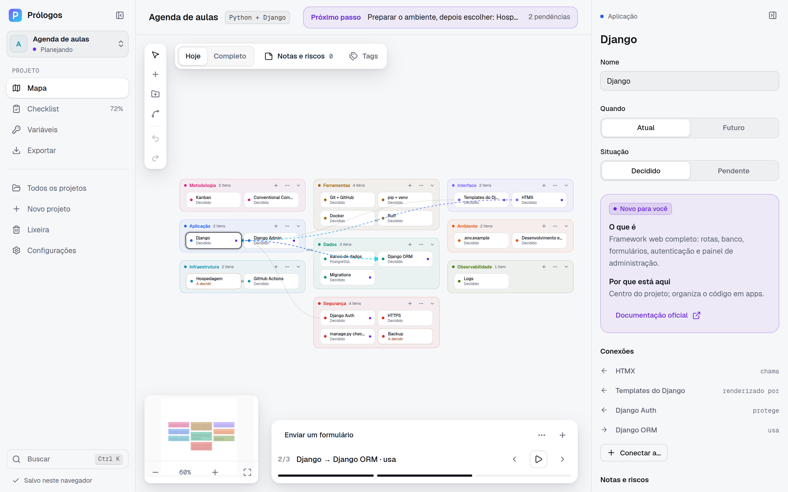
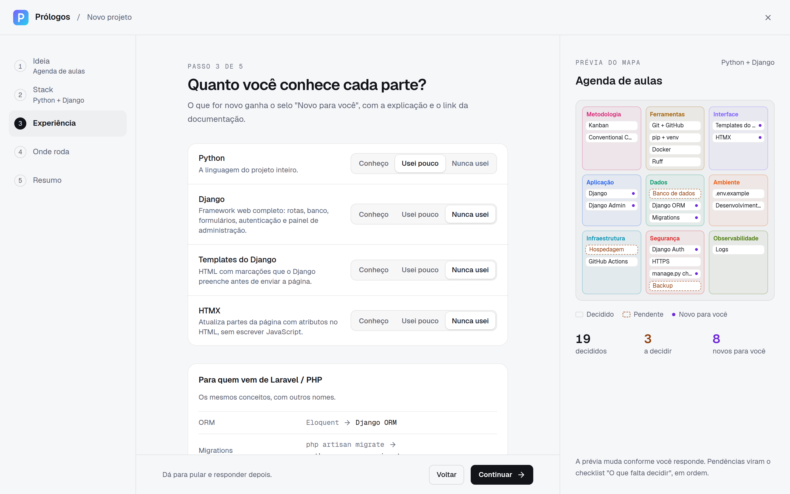
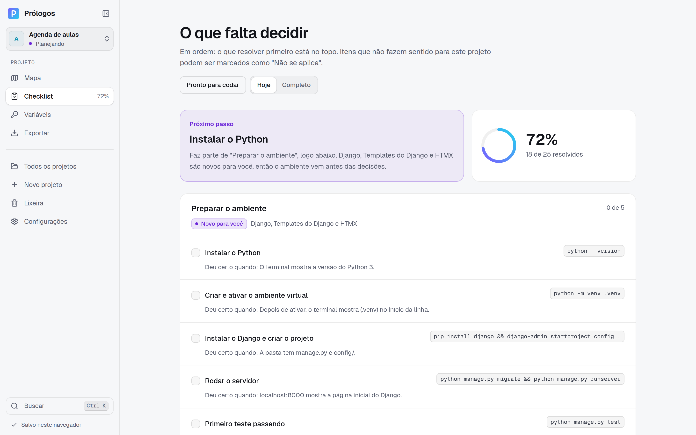
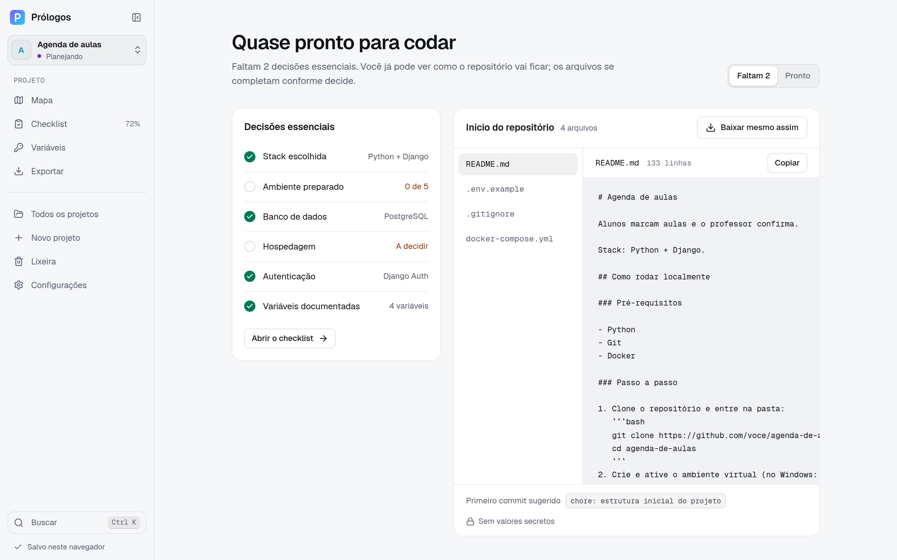
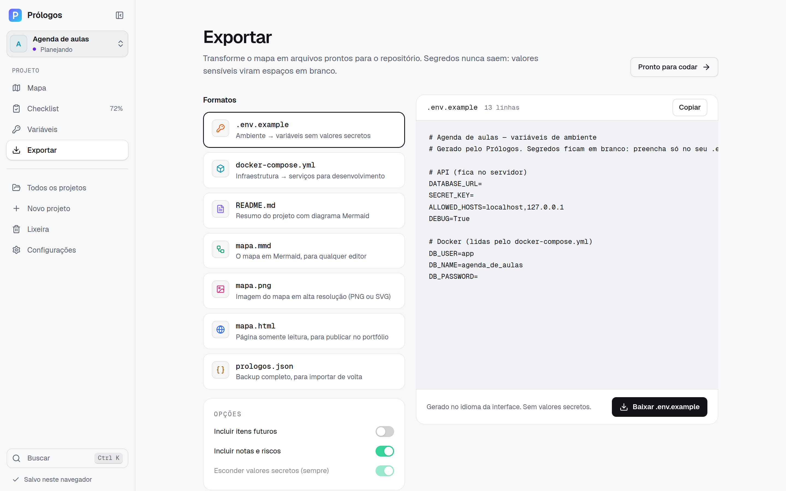
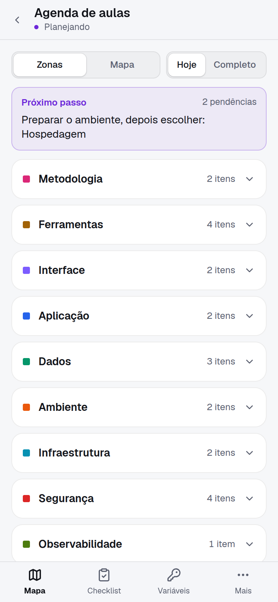
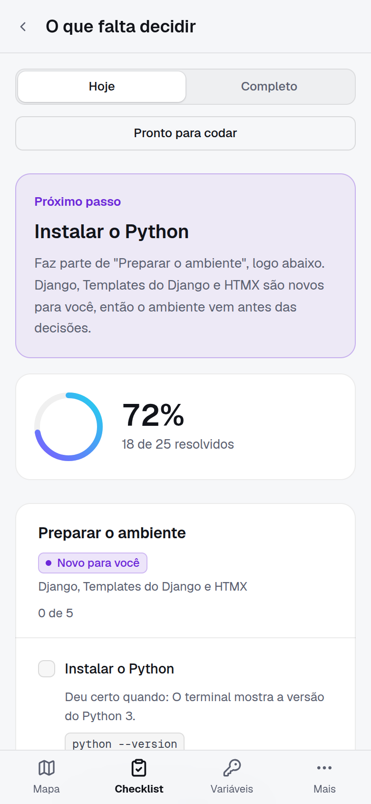

# Prólogos

> Todo projeto começa antes do código.

Prólogos ajuda você a sair do "tenho uma ideia" e chegar ao primeiro commit com tudo decidido: stack, ambiente, dados, infraestrutura, segurança e o que ainda falta resolver, num mapa visual do projeto.

<picture>
  <source media="(prefers-color-scheme: dark)" srcset="docs/prints/mapa-escuro.webp">
  
</picture>

## Para quem é

- Para quem trava no começo de projetos pessoais e de portfólio por não saber o que decidir primeiro.
- Para quem quer começar numa linguagem ou framework que ainda não domina.
- Para devs solo e freelancers que querem padronizar o planejamento.

O Prólogos ajuda a **começar bem**. Ele não é um gerenciador de tarefas e não acompanha a execução do projeto.

## Como funciona

1. **Início guiado:** cinco perguntas sobre a ideia, a stack, o que você já conhece e onde o projeto vai rodar.
2. **Mapa do projeto:** zonas, itens, conexões e fluxos já montados a partir de um kit, com o que está decidido e o que está pendente.
3. **O que falta decidir:** um checklist em ordem, com o próximo passo sempre visível.
4. **Pronto para codar:** o Prólogos gera o início do repositório — README com "como rodar", `.env.example`, `docker-compose.yml` e `.gitignore`.

## Telas

**Início guiado:** quem já domina Laravel vê o equivalente de cada conceito no Django, e o que é novo ganha um selo.

<picture>
  <source media="(prefers-color-scheme: dark)" srcset="docs/prints/inicio-escuro.webp">
  
</picture>

**O que falta decidir:** o próximo passo no topo e a trilha para preparar o ambiente.

<picture>
  <source media="(prefers-color-scheme: dark)" srcset="docs/prints/checklist-escuro.webp">
  
</picture>

**Pronto para codar:** as decisões essenciais e o início do repositório, arquivo por arquivo.

<picture>
  <source media="(prefers-color-scheme: dark)" srcset="docs/prints/pronto-escuro.webp">
  
</picture>

**Exportar:** `.env.example` sem segredos, `docker-compose.yml`, Mermaid, imagem, `mapa.html` e backup.

<picture>
  <source media="(prefers-color-scheme: dark)" srcset="docs/prints/exportar-escuro.webp">
  
</picture>

**No celular:** consulta rápida do mapa e do checklist.

<p>
<picture>
  <source media="(prefers-color-scheme: dark)" srcset="docs/prints/celular-mapa-escuro.webp">
  
</picture>
<picture>
  <source media="(prefers-color-scheme: dark)" srcset="docs/prints/celular-checklist-escuro.webp">
  
</picture>
</p>

## Kits

Laravel + React · Node + React · Java + Spring Boot · C# + .NET · Python + Django · React Native · Flutter · Site estático.

Cada kit explica cada tecnologia, aponta a documentação oficial e traz uma trilha para preparar o ambiente. Se você já domina outra stack, os conceitos aparecem traduzidos a partir dela (ex.: Eloquent → Django ORM).

## Idiomas

Português (Brasil), English e Español.

## Seus dados

Sem conta e sem servidor: os projetos ficam salvos no seu navegador. Exporte um backup em JSON de vez em quando. Para mostrar um projeto, exporte o `mapa.html` e publique onde quiser. O Prólogos nunca guarda valores de variáveis secretas.

## Como rodar localmente

Requisito: Node.js (versão LTS).

```bash
git clone https://github.com/berTrapp/prologos.git
cd prologos
npm install
npm run dev
```

## Tecnologias

React, TypeScript, Vite, Tailwind CSS, shadcn/ui, React Flow, Zustand, Dexie e react-i18next.

## Contribuir

Kits novos e traduções são bem-vindos. Os kits ficam em `src/content/kits/`, um arquivo por kit; o formato está em `docs/kits/`.

O projeto segue o padrão [Conventional Commits](https://www.conventionalcommits.org/pt-br/v1.0.0/):

```text
feat(mapa): adiciona recolher por zona
fix(env): corrige leitura de valores com aspas
docs: atualiza instruções de instalação
```

## Licença

Gratuito e de código aberto, sob a licença MIT. Veja [LICENSE](LICENSE).
